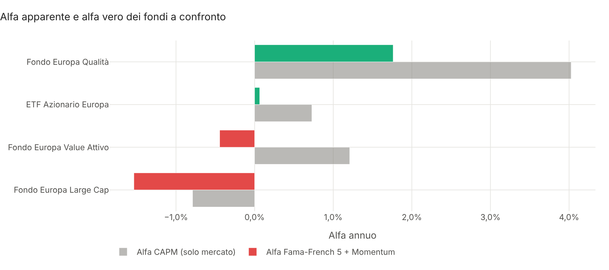
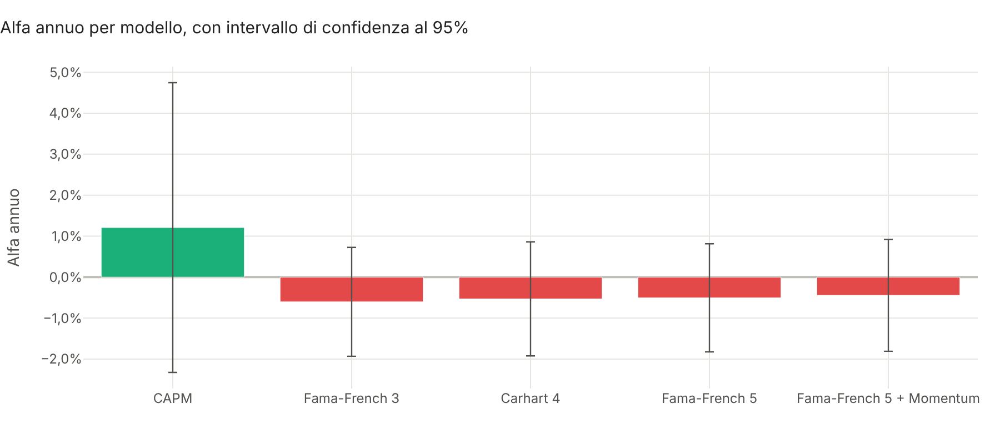
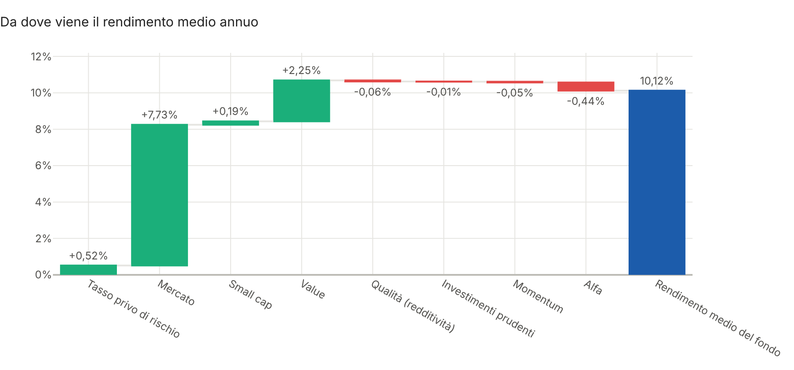
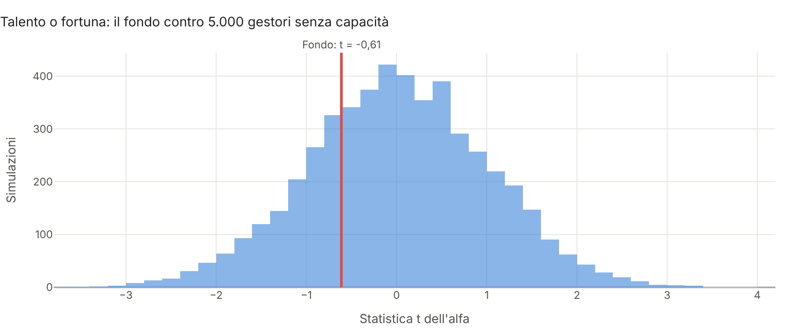
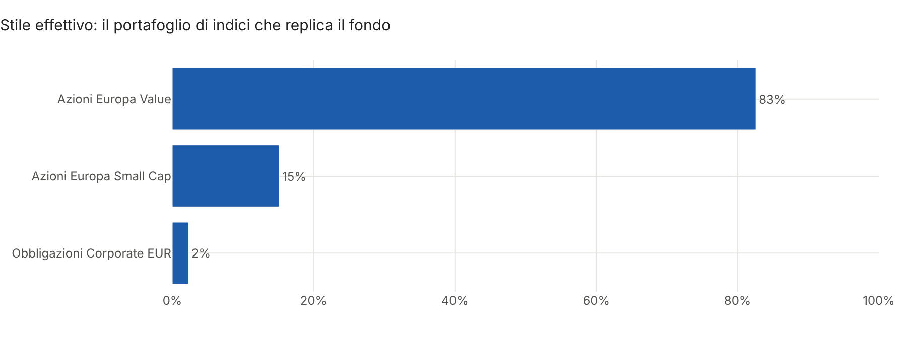
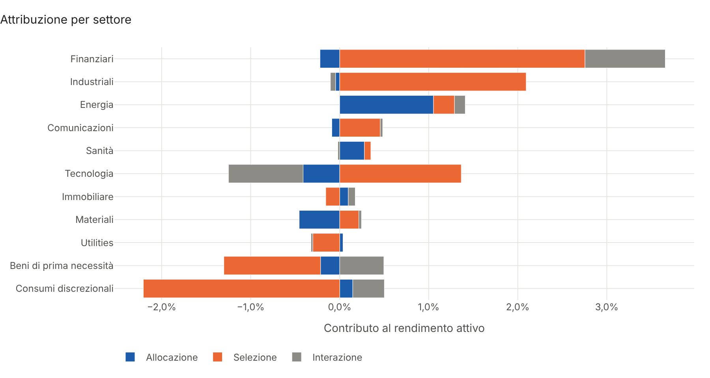
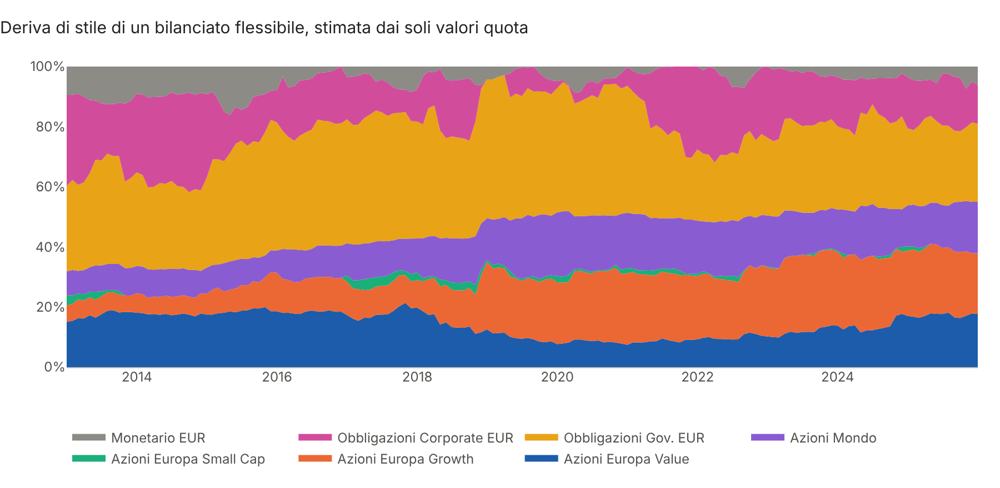

# Factor Attribution

**Valutazione di fondi e gestori in Python: modelli fattoriali, talento o fortuna, style analysis e attribuzione
di Brinson.**

Un fondo che batte il benchmark non ha per forza un gestore bravo. Spesso ha solo preso rischi, come titoli
*value* o piccole società, che nel lungo periodo rendono di più e che oggi si comprano con un ETF a pochi
punti base. Il progetto risponde alle domande che un consulente deve farsi prima di consigliare un fondo attivo:
**il gestore crea davvero valore, o vende a caro prezzo esposizioni replicabili? Il suo alfa è talento o
fortuna? Qual è il suo stile effettivo, e cambia nel tempo? Da quali scelte, settore per settore, viene il
risultato?** Il risultato è un **report HTML interattivo pronto da consegnare al cliente**.



## Cosa fa

| Area | Contenuto |
|---|---|
| **Modelli fattoriali** | CAPM, Fama-French a 3 e 5 fattori, Carhart a 4, Fama-French 5 + momentum; errori standard di **Newey-West**, R² corretto e BIC per scegliere il modello |
| **Scomposizione** | Rendimento medio annuo scomposto esattamente in tasso privo di rischio, premi dei fattori e alfa; varianza scomposta per fattore (contributi di Eulero) e rischio specifico |
| **Talento o fortuna** | **Bootstrap a blocchi** dell'alfa sotto l'ipotesi di gestore senza capacità (Kosowski, Timmermann, Wermers e White, 2006) |
| **Esposizioni mobili** | Beta e alfa su finestre di 36 mesi, per vedere se lo stile e l'alfa sono stabili |
| **Style analysis** | Metodo di **Sharpe** (1992): il portafoglio di indici, con pesi positivi che sommano a 1, che replica il fondo dai soli valori quota; anche su finestre mobili, per scoprire le derive di stile |
| **Attribuzione di Brinson** | Allocazione, selezione e interazione per settore (Brinson-Fachler o Brinson-Hood-Beebower), più periodi collegati con il metodo di **Cariño**, active share |
| **Metriche relative** | Tracking error, information ratio, beta, up e down capture, mesi sopra il benchmark |
| **Dati** | CSV di valori quota o rendimenti, fattori reali scaricati dalla **Kenneth French Data Library** (Europa, Paesi sviluppati, USA), oppure un universo dimostrativo coerente |
| **Report** | HTML in italiano con 12 grafici interattivi Plotly, tabelle e un esito in linguaggio semplice |

Regressioni con `statsmodels` (OLS con errori HAC e `RollingOLS`), ottimizzazione vincolata con `scipy`, dati con
`pandas` e `numpy`, grafici `plotly`, report con `jinja2`.

## Avvio rapido

```bash
git clone https://github.com/Torraf-MI/factor-attribution.git
cd factor-attribution
pip install -e ".[png]"

# Report sull'universo dimostrativo
factor-attribution --demo --cliente "Famiglia Bianchi"
factor-attribution --demo --fondo "Fondo Europa Qualità"

# Dai CSV di esempio: fondi, fattori, indici di stile e pesi per settore
factor-attribution --fondi data/fondi_esempio.csv --fattori data/fattori_esempio.csv \
    --fondo "Fondo Europa Value Attivo" --benchmark "Indice Azionario Europa" \
    --indici data/indici_stile_esempio.csv --settori data/settori_esempio.csv --ter 0.0165

# Con i valori quota dei propri fondi e i fattori europei reali di Fama e French
factor-attribution --fondi valori_quota.csv --french Europe --fondo "Il mio fondo" --benchmark "ETF Europa"
```

Il report viene salvato in `output/report.html` (con `--offline` funziona anche senza connessione, con
`--grafici cartella` salva anche i PNG). Un esempio già generato: [`docs/report_esempio.html`](docs/report_esempio.html).

Il CSV dei fondi ha una colonna di date e una colonna per fondo, con valori quota (giornalieri o mensili) oppure
rendimenti mensili: il formato viene riconosciuto e i prezzi sono convertiti in rendimenti mensili. È lo stesso
formato dei prezzi di [portfolio-optimizer](https://github.com/Torraf-MI/portfolio-optimizer). Per l'attribuzione di
Brinson serve una tabella con una riga per mese e settore: `data, settore, peso_fondo, peso_benchmark, rend_fondo,
rend_benchmark`, come quella che si ricava dalle composizioni mensili del fondo e dell'indice.

## Uso come libreria

```python
from factor_attribution import (analisi_stile, attribuzione_brinson, bootstrap_alfa, confronta_modelli,
                                generate_sample_universe, regressione, scomposizione_rendimento)

u = generate_sample_universe()                 # oppure load_fattori(...) / scarica_fattori_french("Europe")
fondo = u["fondi"]["Fondo Europa Value Attivo"]

print(confronta_modelli(fondo, u["fattori"]))  # alfa, t, R² e BIC per cinque modelli
reg = regressione(fondo, u["fattori"], "Fama-French 5 + Momentum")
print(reg.beta, scomposizione_rendimento(reg))
print(bootstrap_alfa(reg)["p-value una coda"])   # probabilità che sia fortuna
print(analisi_stile(fondo, u["indici"]).pesi)    # stile effettivo
print(attribuzione_brinson(u["settori"]).totale) # allocazione, selezione, interazione
```

Esempio completo, con la deriva di stile di un bilanciato flessibile, in [`examples/esempio.py`](examples/esempio.py).

## Risultati sull'esempio dimostrativo

Quattro fondi azionari europei e il loro benchmark, rendimenti mensili netti dal 2010 al 2025.

| Fondo | Rend. annuo | Tracking error | Information ratio | Alfa CAPM | Alfa multifattore | t |
|---|---|---|---|---|---|---|
| Fondo Europa Qualità | 10,9% | 3,4% | 0,69 | +4,0% | **+1,8%** | **2,79** |
| ETF Azionario Europa | 8,0% | 0,1% | −2,70 | +0,7% | +0,1% | 0,13 |
| Fondo Europa Value Attivo | 8,8% | 5,3% | 0,20 | +1,2% | −0,4% | −0,64 |
| Fondo Europa Large Cap | 6,4% | 0,4% | −3,83 | −0,8% | **−1,5%** | **−2,87** |

Alfa annui con il modello Fama-French 5 + momentum; in grassetto quelli significativi.

**Il caso del Fondo Europa Value Attivo.** Batte il benchmark dello 0,7% l'anno al netto dei costi e,
guardando solo al mercato (CAPM), sembra creare un alfa dell'1,2%. Con i fattori di stile l'alfa diventa −0,4%:
il fondo ha un'esposizione value di 0,63 e small cap di 0,16, che insieme spiegano 2,4 punti di rendimento l'anno.





**Talento o fortuna?** Su 5.000 gestori simulati senza capacità e con le stesse esposizioni, un risultato
almeno così negativo capita nel 26% dei casi: nessuna evidenza di talento, né di incapacità. Il Fondo Europa
Qualità invece supera la soglia che un gestore senza capacità raggiunge per caso solo 5 volte su 100.



**Lo stile effettivo**, stimato dai soli valori quota, è 83% azioni europee value e 15% small cap, con un R² del
96%. Rispetto a questa replica passiva il fondo ha aggiunto lo 0,2% l'anno, meno di quanto costa.



**L'attribuzione di Brinson** sugli ultimi tre anni assegna il 4,7% di rendimento attivo lordo soprattutto alla
selezione dei titoli (+3,4%), concentrata nei finanziari. Il modello fattoriale mostra però che quella
"selezione" è in gran parte la scelta sistematica di titoli value dentro ogni settore: un'esposizione che costa
pochi punti base con un ETF, non l'1,65% annuo del fondo. Nello stesso periodo i costi hanno sottratto il 4,95%.



**Deriva di stile.** La style analysis mobile ricostruisce, dai soli valori quota, come un bilanciato
flessibile è passato dal 30% al 55% di azioni e dallo stile value a quello growth.



Il fondo Large Cap mostra il caso più comune: tracking error dello 0,4%, quindi in pratica un indice, ma con
l'1,75% di costi. L'alfa negativo e significativo è esattamente il costo.

## Metodologia in breve

- **Regressioni**: rendimenti mensili in eccesso sul tasso privo di rischio, rᵢ − rf = α + Σ βₖ fₖ + ε, stimate
  con OLS e errori standard HAC di Newey-West con ⌊4(T/100)^(2/9)⌋ ritardi. Alfa annuo = 12 × alfa mensile.
- **Fattori**: mercato (MKT), small cap (SMB), value (HML), redditività (RMW), investimenti prudenti (CMA) di Fama e
  French (2015), momentum (MOM) di Carhart (1997). Il parser legge direttamente i CSV della Kenneth French Data
  Library, che per Europa e Paesi sviluppati sono in dollari.
- **Scomposizione del rendimento**: con l'intercetta i residui hanno media nulla, quindi media(r) = media(rf) + α +
  Σ βₖ·media(fₖ) vale esattamente. **Del rischio**: quota del fattore k = βₖ·cov(fₖ, βᵀf)/var(r), più var(ε)/var(r).
- **Bootstrap**: si costruiscono rendimenti con le stesse beta e alfa nullo ricampionando insieme fattori e residui
  a blocchi circolari di 6 mesi, e si confronta la statistica t osservata con le 5.000 simulate.
- **Style analysis**: min var(r − Xw) con w ≥ 0 e Σw = 1, problema quadratico risolto con `SLSQP` e gradiente
  analitico; R² = 1 − var(r − Xw)/var(r).
- **Brinson**: allocazione (wₚ − w_b)(r_b,i − R_b), selezione w_b(rₚ,i − r_b,i), interazione (wₚ − w_b)(rₚ,i − r_b,i).
  Collegamento di Cariño: ogni effetto mensile è moltiplicato per kₜ/K, con k = (ln(1+Rₚ) − ln(1+R_b))/(Rₚ − R_b),
  così la somma degli effetti è esattamente il rendimento attivo cumulato.
- **Dati dimostrativi**: fattori con code pesanti (t di Student) e alcuni mesi eccezionali, calibrati sulle medie e
  volatilità indicate; undici settori con esposizioni diverse ai fattori e pesi del benchmark che derivano con i
  prezzi; fondi costruiti come portafogli di settori con sovrappesi, scelta dei titoli e costi. Per questo le analisi
  fattoriali e l'attribuzione di Brinson sono coerenti tra loro.

## Parte di una serie

| Progetto | Domanda a cui risponde |
|---|---|
| [portfolio-optimizer](https://github.com/Torraf-MI/portfolio-optimizer) | Qual è l'allocazione efficiente? (Markowitz, risk parity, backtest) |
| [real-estate-analyzer](https://github.com/Torraf-MI/real-estate-analyzer) | Conviene questo investimento immobiliare? (flussi, mutuo, fiscalità, TIR) |
| [wealth-planner-montecarlo](https://github.com/Torraf-MI/wealth-planner-montecarlo) | Il patrimonio basta per gli obiettivi e la pensione? (Monte Carlo) |
| [wealth-dashboard](https://github.com/Torraf-MI/wealth-dashboard) | Com'è il patrimonio oggi e cosa va fatto? (monitoraggio e ribilanciamento) |
| [portfolio-risk-backtest](https://github.com/Torraf-MI/portfolio-risk-backtest) | Quanto posso perdere e la strategia regge alle crisi? (VaR, stress test, backtest) |
| **factor-attribution** | Il gestore vale quello che costa? (modelli fattoriali, style analysis, Brinson) |

## Struttura

```
src/factor_attribution/
├── dati.py        # CSV, Kenneth French Data Library, universo dimostrativo coerente
├── fattori.py     # CAPM, Fama-French, Carhart, scomposizioni, stime mobili, bootstrap dell'alfa
├── stile.py       # style analysis di Sharpe, anche su finestre mobili
├── brinson.py     # attribuzione di Brinson-Fachler e BHB, collegamento di Cariño, active share
├── metriche.py    # tracking error, information ratio, capture ratio
├── report.py      # analisi completa, grafici Plotly e report HTML
├── cli.py         # riga di comando
└── templates/     # modello del report
data/              # fattori, fondi, indici di stile e pesi per settore dimostrativi in CSV
examples/          # uso come libreria
tests/             # 25 test (pytest), eseguiti a ogni push con GitHub Actions
```

## Test

```bash
pip install -e ".[dev]"
pytest
```

I test verificano, tra l'altro, che la regressione ritrovi esposizioni e alfa noti, che un alfa CAPM dovuto a
un'esposizione value sparisca con il modello a tre fattori, che le scomposizioni di rendimento e rischio sommino al
totale, che il bootstrap distingua un gestore capace da uno fortunato, che la style analysis ritrovi i pesi veri e
riconosca la deriva di stile, che l'attribuzione di Brinson coincida con un esempio calcolato a mano e che il
collegamento di Cariño sia esatto.

## Avvertenze

I dati dimostrativi sono sintetici e non rappresentano fondi, indici o fattori reali. Il progetto ha scopo
illustrativo e non costituisce consulenza finanziaria o raccomandazione di investimento.

## Licenza

MIT
